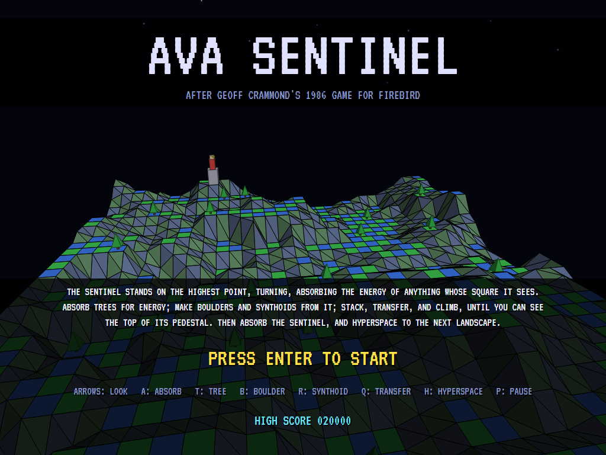
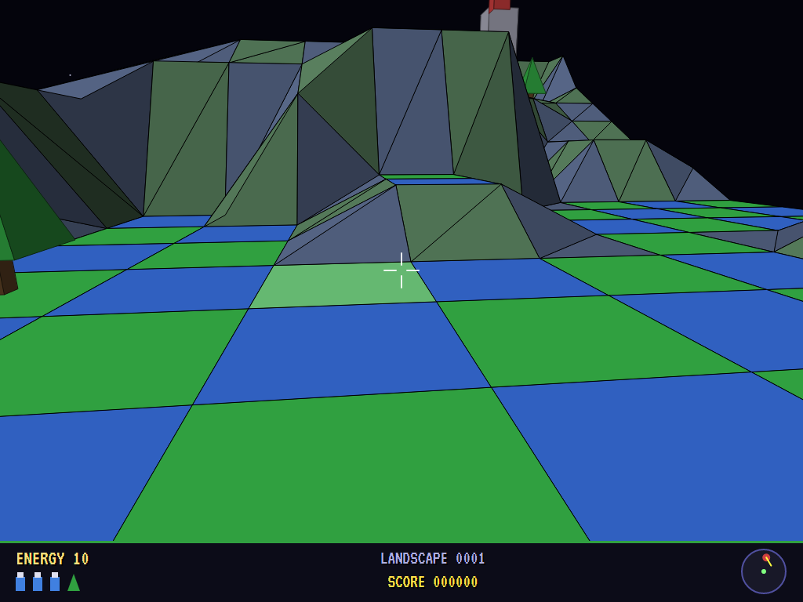
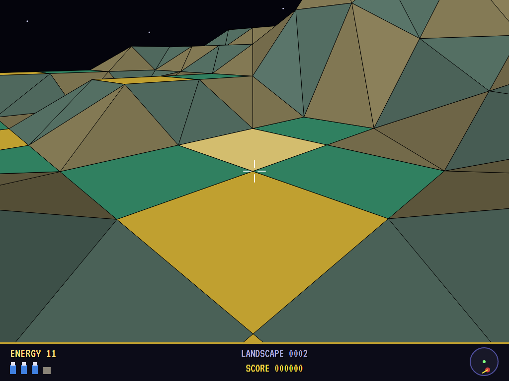
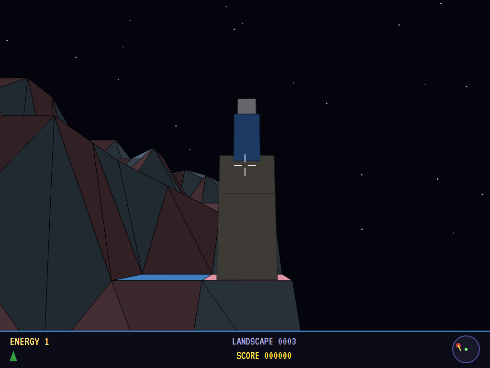
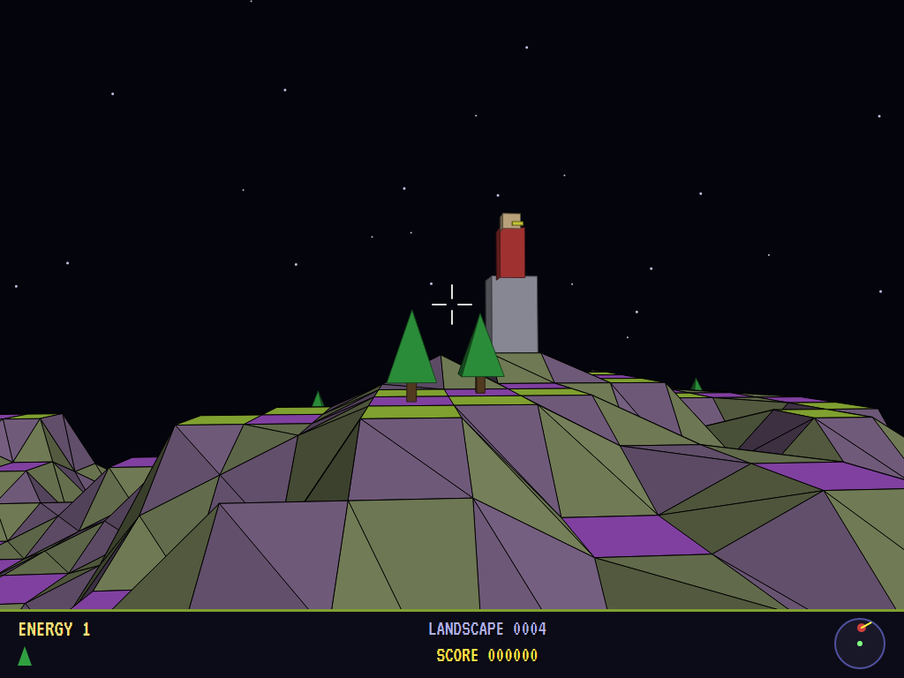
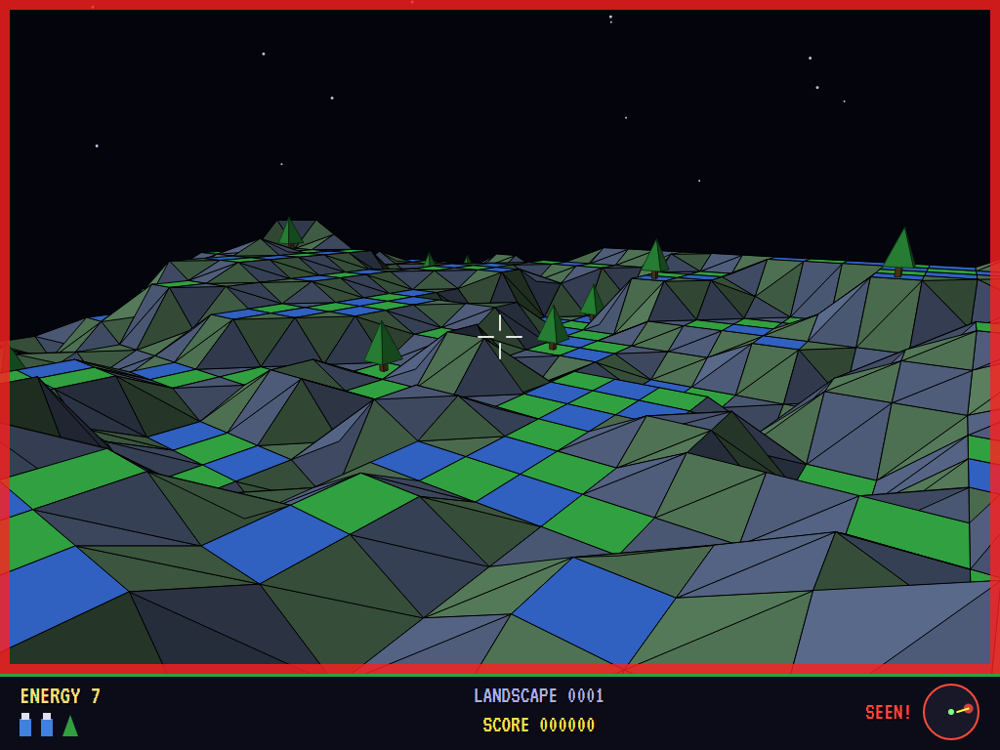
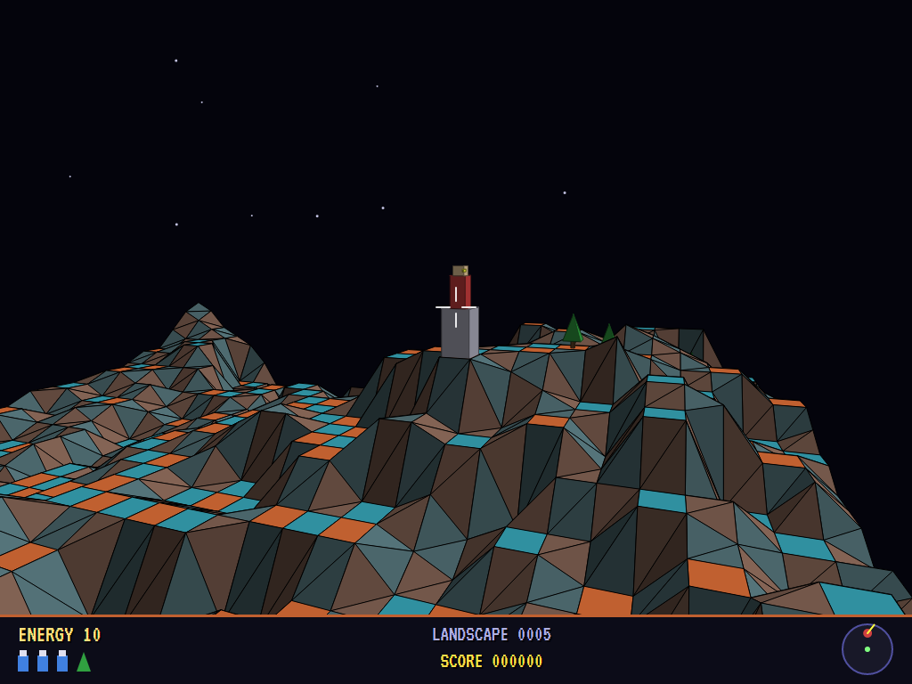
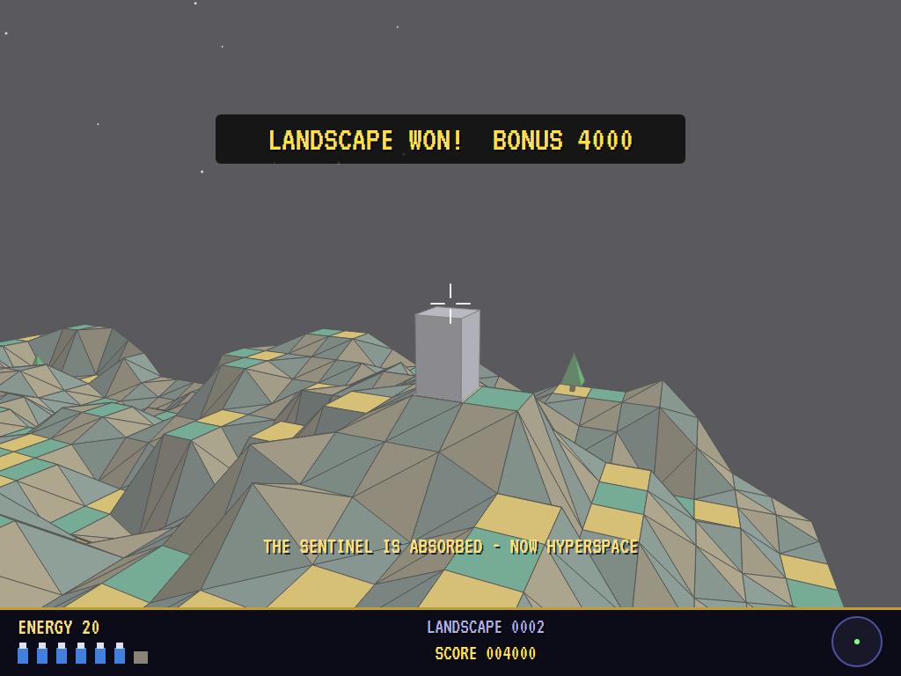
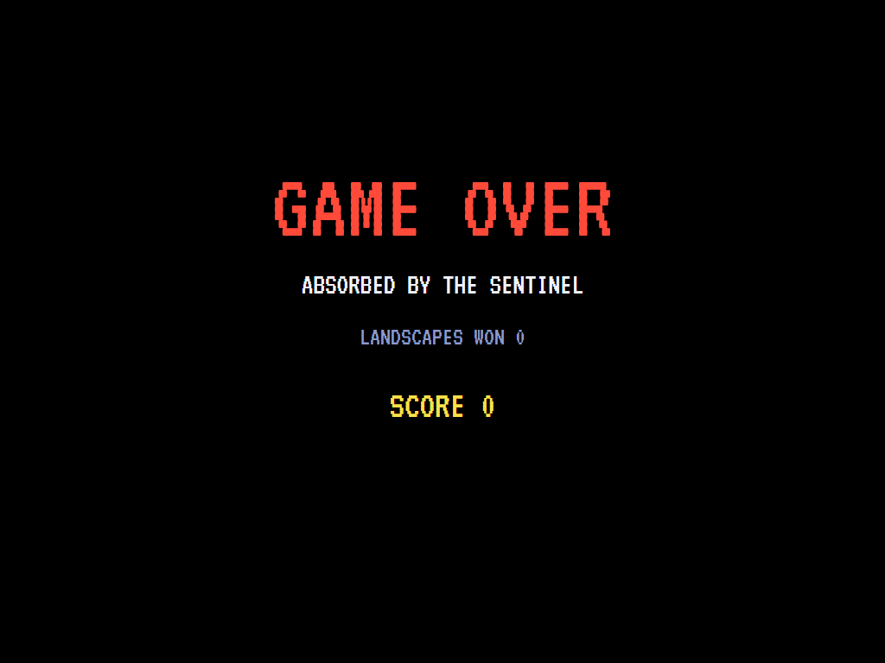
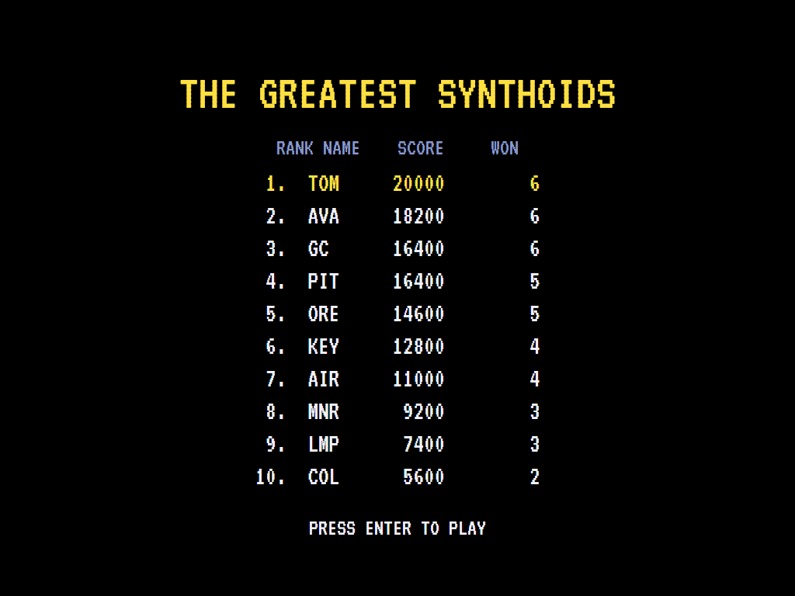

# AVA Sentinel

[](https://github.com/Harlock123/AVASentinel/actions/workflows/build.yml)

A slow, tense game of height and line of sight on a solid 3D landscape, in the style of Geoff Crammond's 1986
game **The Sentinel**. It's built with .NET 10 and Avalonia UI. The Sentinel stands on the highest point of each
landscape. It turns slowly, absorbing the energy of anything whose square it can see. You're a synthoid in a
valley far below. Climb, unseen, until you can look down on the top of its pedestal. Then absorb it and
hyperspace to the next landscape.

## Features

- **A solid landscape,** seen through the synthoid's eyes: thirty-two squares by thirty-two, drawn farthest
  first. Flat squares are checkered and slopes are shaded by the light, under a starry sky.
- **Energy is everything.** Absorb a tree for one unit, a boulder for two, a synthoid for three. Spend it to
  make them on squares you can see. Absorbing and creating are only allowed on a square you can see: its
  ground from above, or the top of the boulders stacked on it.
- **How to climb:** stack boulders on a square in view, put a synthoid on top, transfer into it, and absorb the
  body (and boulders) you left behind. Each move costs time, and the Sentinel keeps turning.
- **The Sentinel** turns a step at a time. When it can see your square it drains your energy, one unit at a
  time, into new trees about the landscape. Run out and you're absorbed. A compass on the panel shows where it
  stands and which way it looks.
- **Hyperspace** costs three units and drops you somewhere no higher. With the Sentinel absorbed, it takes you
  to the next landscape, and the energy you have left is your score.
- **Eight landscapes,** each built from its own seed: rolling hills quantized into steps, with flats to build on.
  Each is higher and more rugged than the last, with a quicker Sentinel.
- **The attract mode** shows the computer player at work. It absorbs the trees it can see, builds on the
  highest square in view, and climbs. It gets out of sight when the Sentinel turns its way. Every act is
  aimed: it turns and tilts the view until the square is in its sights.

## Screenshots

| The title | The first look | Trees for energy |
|:---------:|:--------------:|:----------------:|
|  |  |  |
| The Sentinel, on the highest point. | Down in a valley. | Absorbing what's in sight. |

| Boulders | Up high | Seen! |
|:--------:|:-------:|:-----:|
|  |  |  |
| A stack, and a synthoid on top. | Nearly level with it. | Its gaze drains your energy. |

| In the sights | Won | Game over |
|:-------------:|:---:|:---------:|
|  |  |  |
| Looking down on its pedestal. | Into hyperspace. | |



The screenshots are made by the tests, which play the game in a real (headless) window; see
[Tests](#tests).

## Download and run

Ready-to-run builds for Windows, macOS and Linux, on both Intel/AMD and ARM, are on the
[Releases page](https://github.com/Harlock123/AVASentinel/releases/tag/latest). **Latest build** is
rebuilt on every push to `main`. Each download is one self-contained executable: no .NET install is
needed.

| Platform | Archive |
|---|---|
| Windows | `AVASentinel-win-x64.zip`, `AVASentinel-win-x86.zip`, `AVASentinel-win-arm64.zip` |
| macOS | `AVASentinel-osx-arm64.tar.gz` (Apple silicon), `AVASentinel-osx-x64.tar.gz` (Intel) |
| Linux | `AVASentinel-linux-x64.tar.gz`, `AVASentinel-linux-arm64.tar.gz`, `AVASentinel-linux-arm.tar.gz` |

```bash
tar -xzf AVASentinel-linux-x64.tar.gz     # or linux-arm64, linux-arm, osx-arm64, osx-x64
./AVASentinel
```

On Windows, unzip and run `AVASentinel.exe`. On macOS, if Gatekeeper refuses to open it, run
`xattr -d com.apple.quarantine AVASentinel` once. Run with `--no-audio` for silence.

**Sound** comes through OpenAL Soft, built in for every platform. In a virtual machine the game
detects it and uses a larger audio buffer, so the sound doesn't break up.

**Gamepads** use SDL2, which is bundled for Windows, macOS and Intel/AMD Linux. ARM Linux builds need it
installed; without it the keyboard still works:

```bash
sudo apt install libsdl2-dev            # Debian / Ubuntu / Raspberry Pi OS
sudo pacman -S --needed sdl2-compat     # Arch / Omarchy
```
## Controls

| Action | Keyboard | Gamepad |
|---|---|---|
| Start | Enter or 1 | Start |
| Look round / up and down | Arrows | Left stick / D-pad |
| Absorb | A | A |
| Make a tree / a boulder / a synthoid | T / B / R | Left bumper / B / X |
| Transfer into the synthoid in the sights | Q | Y |
| Hyperspace | H | Right bumper |
| Pause | P or Esc | Start or Back |
| Sound on/off | M | |
| Screenshot | Ctrl+S (to your Pictures folder) | |

On the high-score table, type your initials, or use up/down and Space, then Enter.

## Tests

```bash
dotnet test AVASentinel.slnx
```

The game runs in fixed 60 Hz steps, so it plays the same at any frame rate. Everything that changes lives in
one world that can be copied. The tests check:

- **The landscapes:** the Sentinel on the highest flat square and the player low down, far away; trees on flats
  and plenty to build on; the ground blending between corners; a hill hiding what's behind it; the same
  landscape every time, each quicker than the last.
- **Playing:** looking round; the square in the sights; making things costing energy and absorbing giving it
  back; not enough energy; transferring into a synthoid on boulders and the eye higher, and the old body
  absorbed; a square behind a hill out of reach; the Sentinel draining a player it sees into a new tree, and
  facing away seeing nothing; the Sentinel absorbed only from above its pedestal, and hyperspace winning;
  hyperspace costing a synthoid, and without the energy, the end.
- **The game:** a landscape won and on to the next; absorbed is game over; the demonstration; pause; the keys.

`tests/AVASentinel.Tests/PilotProbe.cs` reports how the computer player gets on on each landscape, for tuning
(`SENT_PROBE=1`). It wins all eight. `SENT_PROBE=lazy` looks round absorbing at random, and is absorbed or gets
nowhere.

The screenshot tests draw the real screen in a headless window. To refresh the README's pictures:

```bash
SENT_SHOTS=$PWD/Images dotnet test tests/AVASentinel.Tests --filter ScreenshotTests
```

## Building

```bash
dotnet build AVASentinel.slnx
dotnet run --project src/AVASentinel
```

Needs the .NET 10 SDK. The sounds, tunes and voice are made by `tools/make_sounds.py` (standard-library
Python, with the formant voice in `tools/speech.py`): `python3 tools/make_sounds.py` rewrites
`src/AVASentinel/Sounds`. Both tunes are new compositions.

## Project structure

```
AVASentinel/
├── AVASentinel.slnx
├── src/AVASentinel/
│   ├── Engine/
│   │   ├── GameEngine.cs        # States, landscapes in turn, the score, the title and demonstration
│   │   ├── Sim.cs               # Looking, the acts, line of sight, the Sentinel's turning and draining
│   │   ├── World.cs             # What stands where, the player's eye, kept together so it can be copied
│   │   ├── Landscape.cs         # The landscapes, built from seeds
│   │   ├── Pilot.cs             # The computer player (the demonstration, and the tests)
│   │   ├── HighScoreTable.cs, InitialsEntry.cs
│   │   ├── InputHandler.cs, ControllerManager.cs  # Keys and an SDL2 gamepad
│   │   └── SoundManager.cs      # Effects, tunes and voice through OpenAL
│   ├── Audio/                   # The OpenAL engine (from the author's AVABand)
│   ├── Views/GameCanvas*.cs     # The landscape in 3D, the panel, the title
│   └── Sounds/                  # The synthesised effects, tunes and voice
├── tests/AVASentinel.Tests/     # Landscape, gameplay and screenshot tests
├── tools/make_sounds.py, tools/speech.py
└── Images/                      # Screenshots
```

## About and licence

AVA Sentinel © 2026 Lonnie Watson, under the [MIT License](LICENSE).

*The Sentinel* © 1986 Firebird (written by Geoff Crammond); the names *The Sentinel* and *synthoid* belong to
their current owner. AVA Sentinel is an independent, unofficial game in its style. Its landscapes, graphics,
sounds, tunes and code are its own; nothing is taken from the original game's program, graphics or sound. It
is not affiliated with or endorsed by any rights holder.
